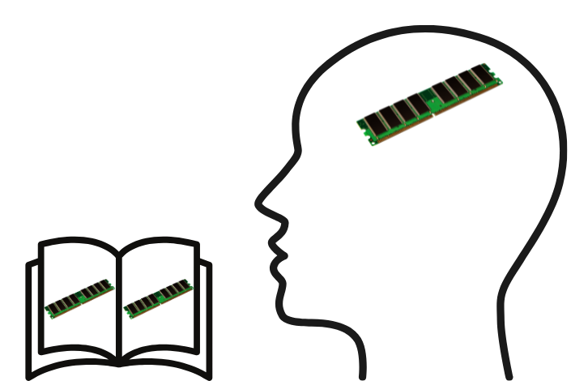

Ostatnio czytam dużo tekstów napisanych przez AI. Nie dlatego, że chcę, tylko
dlatego, że muszę. I w tej burzy słów przewija mi się ciągle myśl “pisanie to
narzędzie do lepszego myślenia”. Skąd mam taki pomysł w głowie? I czy to w ogóle
prawda?

<!--truncate-->

Ludzie online, którzy zawodowo zajmują się czymś innym niż pisanie, produkują
teraz ogromne ilości tekstu. Część z tego tekstu to zachwyt nad nowym stanem
świata i wdzięczność za niego — że wreszcie pisanie stało się dostępne dla
każdego. Że wygrała pomysłowość, która była ukryta za barierą nieumiejętności
wyrażania swoich myśli (lub brakiem czasu na robienie tego). Że pisanie nie jest
już ważne, bo LLM może to zrobić i w ogóle pisanie to szczegół w porównaniu z
Głęboką Myślą i Kreatywnością Wielkich Umysłów. Że pisać ej-ajem można
dokumentację techniczną, posty na Linkedinie, artykuły prasowe i literaturę.
Zarabiaj na swoich powieściach o wilkołakach-milionerach! Teraz świat wreszcie
pozna twój geniusz!

Ludzie, którzy zawodowo zajmują się pisaniem, ubolewają nad tym stanem rzeczy.
Ja też nad nim ubolewam i szukam pocieszenia — czegoś, co powie mi, że całe
życie zainwestowane w umiejętność pisania nie było zmarnowane. I jest jedna
myśl, która daje mi takie pocieszenie: że pisanie to narzędzie do lepszego
myślenia. Czasem widzę to w postach lub artykułach, których nie zacytuję, żeby
nie wciągać niewinnych ludzi w moją wojnę z pomysłami innych niewinnych ludzi.
Dlatego poszukałem czegoś, co jest o kilka kroków lepsze niż opinie ludzi w
social mediach: **badań**! Czy je znalazłem? Czy musiałem przeprowadzić własne?

## Lepsze decyzje — lepszy biznes

Zacznijmy przyziemnie: czy pisanie jest dobre dla biznesu? Czy można dzięki
niemu lepiej zarabiać i wzbogacić swoje portfolio? Temat ten wzięła na tapet
strona Kuźnia Leaderów w artykule pod tytułem
“[Podejmowanie decyzji może być łatwe](https://kuznialeaderow.pl/podejmowanie-decyzji-moze-byc-latwe/)” (strona ma nieważny certyfikat, ale czytanie jej nie powinno być niebezpieczne).
Czy to wiarygodne i naukowe źródło informacji? Pewnie nie, ale jest to źródło
bardzo biznesowe i cytuje inne biznesowe źródła o podobnych intencjach —
biznesowych.

Co jest w tym artykule? W skrócie mowa o tym, że przeniesienie myśli na
przysłowiowy papier pozwala je lepiej zorganizować. Teza wydaje się intuicyjna i
poparta moim doświadczeniem. Konkretniej, artykuł proponuje technikę
“scenariusza zysków i strat”.

Ta technika ma bardzo dużo sensu dla mnie, bo jeśli tylko sobie pomyślę “czy
zjeść lody na kolację”, to intuicyjna odpowiedź oczywiście brzmi: tak, czemu
nie? Ale scenariusz zysków i strat rysuje się następująco:

| Podjęta decyzja      | Scenariusz zysku                                                                                                                                                                     | Scenariusz straty                                                                                                                                                                                                 |
| :------------------- | :----------------------------------------------------------------------------------------------------------------------------------------------------------------------------------- | :---------------------------------------------------------------------------------------------------------------------------------------------------------------------------------------------------------------- |
| Tak, lody na kolację | Lody są pyszne i dadzą mi trochę chwilowej frajdy. Ale jeśli mam być szczery, to będzie bardzo chwilowa frajda, a potem pewnie będę miał poczucie winy. Poza tym będę po nich gruby. | Ominie mnie fantastyczny smak lodów, ale jak już pisałem w sąsiedniej kolumnie, ominie mnie też poczucie winy i bycie grubym.                                                                                     |
| Nie, coś innego      | Zjem coś z witaminą i błonnikiem. Jakieś warzywka pokrojone, domowy vinegrette, może feta. Do tego kanapeczka na razowym chlebie. Umrę kiedyś zdrowszy.                              | Więcej roboty z tym wszystkim, ale dochodzi jeszcze poczucie spełnionego obowiązku osoby dorosłej (dbanie o siebie) i dawanie przykładu innym (jeśli akurat sąsiad mnie zobaczy przez okno, że pałaszuję sałatkę). |

Dogłębna analiza tych scenariuszy pokazuje, że jednak “coś innego niż lody” ma
właściwie ogromną przewagę. Czyli dowiodłem doświadczalnie, że pisanie
doprowadziło mnie do podjęcia lepszej decyzji.

Czy w końcu zrobię sałatkę, czy jednak zjem te lody? Tylko czas pokaże.

Czy można to zastosować do poważnych tematów biznesowych? Dajmy na to: czy
napisać te docsy w dicie, markdownie, czy Microsoft Wordzie?

| Podjęta decyzja | Scenariusz zysku                                                                                                                                                                                                                                                                                  | Scenariusz straty                                                                                                                                                                       |
| :-------------- | :------------------------------------------------------------------------------------------------------------------------------------------------------------------------------------------------------------------------------------------------------------------------------------------------ | :-------------------------------------------------------------------------------------------------------------------------------------------------------------------------------------- |
| Użyję DITA      | Będę mógł zastosować reuse i dzięki temu bardziej ustandaryzować treści notek i ostrzeżeń. Będę mógł powtórzyć pewne rzeczy kilka razy, żeby zawsze były dostępne w kontekście, na przykład powtórzyć kroki nadawania użytkownikom uprawnień za każdym razem jak tworzymy konkretny typ projektu. | Tylko tech writer z Oxygenem będzie mógł kontrybuować do docsów. Nie mogę oczekiwać, że ktoś zrobi review w diffie na GitHubie. Powtarzane w kółko treści zapchają wyniki wyszukiwania. |
| Użyję Markdown  | Każdy developer w firmie będzie mógł kontrybuować do docsów. Bez reusu wyniki wyszukiwania będą bardziej jednoznaczne, a zawsze mogę dodać linki do często powtarzanych kroków. Użytkownicy raz się nauczą nadawać uprawnienia i potem będą to robić z pamięci.                                   | Nie mogę robić reusu, a mogę co najwyżej powtarzać te same treści. To może być problemem przy masowych zmianach w przyszłości.                                                          |
| Użyję Worda     | Każdy, kto ma Worda może zmieniać docsy, komentować, proponować, redagować, itp. Nie tylko tech writerzy i deweloperzy.                                                                                                                                                                           | Problemy z DTP i spójnością wyglądu. Publikowanie “ręcznie”.                                                                                                                            |

Sprawa jest dużo bardziej wielowymiarowa niż w przykładzie z lodami, ale
odkryłem, że muszę dostosować scenariusze do tego co jest realne w danym
wypadku. Na przykład napisałem o procedurze nadawania uprawnień użytkownikom,
która przydaje się za każdym razem kiedy tworzymy nowy projekt i założyłem, że
są różne typy projektów. To nie jest uniwersalne stwierdzenie typu “dobrze jest
reusować docsy”, bo to stwierdzenie nie jest jednoznacznie prawdziwe w
absolutnej próżni. Pytanie o reuse powinno się rozpatrywać na konkretnych
realnych scenariuszach.

Jeżeli chciałbym zrobić tę analizę dla prawdziwych docsów, miałaby na pewno dużo
więcej przykładów z życia wziętych. Musiałbym też szczerze odpowiedzieć sobie na
pytanie kto będzie edytował docsy. Tylko tech writerzy? Czy możemy liczyć na
deweloperów? Czy potrzebujemy pomocy PMów albo innych osób nietechnicznych.

Rozpisywanie problemów w ten sposób mnie intryguje. Na pewno zastosuję to
następnym razem, kiedy będę podejmował skomplikowaną decyzję.

## Zdrowsza głowa dzięki pisaniu

Następny artykuł pokazuje, że pisanie to nie tylko droga do zdrowszej diety, ale
też zdrowszej głowy. Rzeczpospolita daje nam artykuł pod tytułem
“[Oto, co się dzieje w mózgu, gdy pisze się pamiętnik. Każdy powinien to wiedzieć](https://kobieta.rp.pl/psychologia/art42415901-oto-co-sie-dzieje-w-mozgu-gdy-pisze-sie-pamietnik-kazdy-powinien-to-wiedziec)”.
Wow, kolejne fantastyczne źródło, Paweł! Dobra robota.

Dobrze, dziękuję. Nie po to wziąłem się za pisanie artykułu, żeby jakiś
wewnętrzny krytyk krzyżował mi plany. Zobaczmy na jakie źródła się powołują?

> Jennifer Aniston prowadzi pamiętnik od 13 roku życia. Zapisuje w nim szczegóły
> dotyczące przyjaźni, obowiązków szkolnych i zawodowych, spotkań rodzinnych, a
> także zawiłości w swoim życiu uczuciowym. Regularne zapiski prowadzi też Lady
> Gaga, która nie rozstaje się ze swoim pamiętnikiem nawet wyruszając w trasę
> koncertową. Poza pomysłami na nowe artystyczne przedsięwzięcia, kreatywna
> wokalistka umieszcza tam ręcznie tworzone obrazki, szkice, a także wkleja
> zdjęcia i fragmenty listów wymienianych ze swoją mamą Cynthią.

Okej, znane osoby to tylko ilustracja. Ale skąd twierdzenie, że to dobrze?
Źródłem informacji jest dr Agnieszka Gawor, doktor nauk humanistycznych w
obszarze psychologii, wykładowczyni na Uniwersytecie WSB Merito we Wrocławiu.

Co twierdzi pani psycholog? Po pierwsze, nasza głowa ma ograniczoną “pamięć
operacyjną” (taka analogia do komputera) i zapisując myśli na papierze,
przenosimy część informacji na “dysk zewnętrzny”. “To dlatego często dopiero
podczas pisania dostrzegamy połączenia między wydarzeniami, które wcześniej
umykały uwadze” – zauważa dr Agnieszka Gawor. Czyli na przykład wydawało nam
się, że jesteśmy źli bo ktoś nam nie przytrzymał drzwi, a tak naprawdę
odreagowujemy wcześniejsze spięcie z kolegą z pracy.

Poza tym, pisanie pozwala nam zdystansować się do sytuacji, zwłaszcza kiedy
opiszemy ją z perspektywy bezstronnej (lub przynajmniej postaramy się to zrobić)
lub chociażby użyjemy sformułowań jak “to, co się wydarzyło” zamiast “to, co
mnie spotkało”. “Wydarzyło” to obiektywny fakt, a “spotkało” sugeruje
niesprawiedliwość dotykającą mojej osoby.

To trochę tak jak to, co się dzieje z moim tokiem myślenia podczas pisania tego
artykułu. Napisałem, że ktoś tam mówi, że AI zastępuje potrzebę pisania. Kto tak
mówi? Jacyś ludzie, których nie znam. Jak na to zareagowałem? Napisałem, że nie
znają się na rzeczy i zrobiłem sobie z nich podśmiechujki. Dlaczego mnie
właściwie dotknęło, że tak pisali? Bo boję się, że ludzie, którzy decydują o
moim zatrudnieniu zdecydują, że nie jestem już potrzebny. Wtedy chciałbym
myśleć, że ci ludzie są głupi, a nie ja. Czy to pewne, że zwolnią mnie przez AI?
Nie jest to pewne, chociaż może się zdarzyć. Czy to będzie oznaczało koniec
mojego życia albo inną tragedię? Nie, życie potoczy się dalej.

Kurczę, muszę stwierdzić, że pisanie faktycznie działa. Już się czuję lepiej, a
wystarczyło tylko rozpisać to co mnie spotkało i moja głowa była zmuszona do
nieco bardziej obiektywnej analizy. Sam fakt zapisywania zdań na papierze
popychał mnie do nazywania uczuć i wyciągania wniosku za wnioskiem.

Polecam tę metodę. Pozwala ochłodzić sobie głowę w przypływie emocji i
zareagować z większą rozwagą. To tak jak pisze mój kolega z redakcji, Andrzej
Niewiarowski: “Dobrym ćwiczeniem jest nazywanie uczuć, pisanie w tym pomaga. A
jak opiszesz je jednego dnia i wrócisz do nich innego to widzisz to z dystansem
i w innym stanie ducha. Nie polecam pisać maili z wściekłością i od razu
wysyłać.”

## Na papierze, czarno na białym

Jeszcze jedna rzecz mi się rzuciła w oczy:
“[Pisanie ręczne poprawia pamięć i pomaga się uczyć](https://naukawpolsce.pl/aktualnosci/news%2C100343%2Cpisanie-reczne-poprawia-pamiec-i-pomaga-sie-uczyc.html)”.
A więc teza jest taka, że pisanie ręczne ma przewagę nad pisaniem na
klawiaturze. Kto głosi takie rewelacje? Portal Nauka w Polsce, który działa od
2004 r. w wyniku współpracy Ministerstwa Nauki (obecnie Ministerstwa Nauki i
Szkolnictwa Wyższego) oraz Polskiej Agencji Prasowej. Brawo, Paweł! Nareszcie
jakieś wiarygodne źródło!

Na kogo się powołują? Na naukowców z Norweskiego Uniwersytetu Nauki i
Technologii (NTNU) w Trondheim. I co ci naukowcy twierdzą?

> “Podczas pisania ręcznego wzorce połączeń mózgowych są znacznie bardziej
> rozbudowane niż w trakcie pisania na klawiaturze” – powiedziała prof. Audrey
> van der Meer, neuropsycholożka z uniwersytetu w Trondheim i współautorka pracy
> opublikowanej w “Frontiers in Psychology”. Badaczka dodała, że taka wzmożona
> aktywność mózgu ma kluczowe znaczenie dla tworzenia się śladów pamięciowych i
> kodowania nowych informacji, czyli jest korzystna dla uczenia się.

Przyznam, że bardzo mało piszę ręcznie, co mocno widać po moim niechlujnym
charakterze pisma. Ale zauważyłem, że odkąd spisuję na papierze plany na
najbliższe dni, dużo lepiej o nich pamiętam. Wcześniej wklepywałem wszystko
tylko do Kalendarza Google, ale teraz robię na papierze notatkę z garścią
szczegółów na temat tego, co mam do zrobienia, i dużo częściej zdarza mi się, że
wiem, co będzie, zanim pojawi się przypomnienie.

## Słowo pisane potrzebuje ciebie, żeby myśleć?

Kolega redakcyjny Andrzej Niewiarowski podsunął mi pewną kwestię związaną z
pisaniem. Powiedział tak:

> Gdy dłuższy czas piszesz artykuł czy powieść, po drodze odkryjesz rzeczy o
> których wcześniej byś nie pomyślał. Odkryjesz nowe fakty, ułożysz na nowo
> informacje, zdobędziesz inną perspektywę niż wcześniej.

> Jeden pisarz powiedział że to "książki piszą opowieści za pomocą autorów". Sam
> proces tworzenia potrafi być wzbogacający. Nie chodzi tylko o finalny
> tekst/ostateczny rezultat. Równie ważna jest droga do niego.

“Książki piszą opowieści za pomocą autorów” to bardzo poetycka myśl. Który
pisarz to powiedział? Nie potrafiłem znaleźć tego cytatu bezpośrednio, ale
pamiętam, że Stephen King pisał coś podobnego w swojej książce “Jak pisać”.
Zarzekał się, że kiedy zaczyna pisać to często nie wie jak potoczą się losy
bohaterów — pozwala im działać, reagować, myśleć i mówić. Opowieść wyłania się
jak znalezisko archeologiczne, które jest powoli odsłaniane łopatką i miotełką.

Wydaje mi się osobiście, że jeżeli piszemy szczerze realistycznie, rzeczywistość
zaczyna prześwitywać przez nasz tekst i możemy zobaczyć jej dowolnie wybrany
fragment w takim zbliżeniu lub oddaleniu jak tylko potrzebujemy.

## Moje “badania”

Jako autor dokumentacji i nauczyciel odkryłem jeszcze jedno ciekawe zjawisko,
które chciałbym Wam teraz opisać. Kiedy coś przeczytam — wydaje mi się, że to
wiem. Kiedy próbuję to komuś przekazać — okazuje się, że jednak nie wiem aż
tyle, ile mi się wydawało.

Najwięcej o regułach języka angielskiego dowiedziałem się nie wtedy, kiedy się
ich uczyłem i robiłem ćwiczenia, ale wtedy, kiedy próbowałem wytłumaczyć je moim
uczniom. Analogicznie, kiedy tylko piszę dokumentację, uświadamiam sobie własne
braki w wiedzy na dany temat i to jest pierwszy krok, żeby je uzupełnić.
Rozpoczynam wtedy cykl pisania, sprawdzania szczegółów w źródłach, dopytywania,
testowania w praktyce i wreszcie dopisywania. Zanim skończę dany fragment
dokumentacji, moja wiedza znacznie się zwiększa.

Zdarzało mi się odkryć luki w wiedzy tak duże, że spędziłem kilka miesięcy na
nauce — na przykład na nauce programowania w Reakcie — żeby móc pisać lepszą
dokumentację.

Czy można tę obserwację potraktować jako “badania”? Nie. Ale to fajna anegdota.

## No i co? (tzw. “wnioski”)

Pisząc ten krótki artykuł przeżyłem niebagatelne wzloty i upadki. Po pierwsze,
wyraziłem swój niesmak wobec klimatu online wokół pisania.

Po drugie, dowiedziałem się, że pisanie może mi pomóc podjąć lepsze decyzje (w
tym decyzje o diecie). Wypróbuję te techniki przy podejmowaniu najbliższej
decyzji biznesowej. Liczę na ogromny zwrot z inwestycji. 😉

Po trzecie, dowiedziałem się, że noszę w sobie strach, który manifestuje się w
postaci podśmiechujek. Może teraz, kiedy wiem, co leży u podstaw mojego lęku,
będę mógł lepiej zaakceptować odcienie szarości w mojej relacji z LLM-ami? Czy
LLM może stać się naprawdę potężnym narzędziem myślenia, jeżeli użyjemy go
prawidłowo?

Po czwarte, odkryłem, jak pisanie pomaga mi zdobywać wiedzę. Postanawiam już
dzisiaj, że będę więcej pisać i przez to więcej się uczyć.

Ostatecznie myślę, że warto było napisać ten artykuł. Mam nadzieję, że warto go
było też przeczytać.

A Wam pisanie pomaga myśleć?
